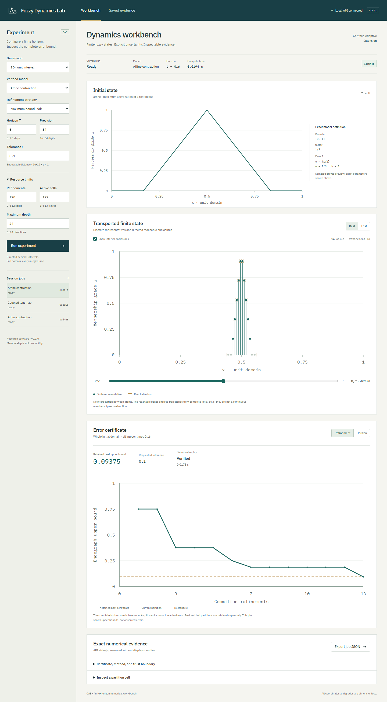
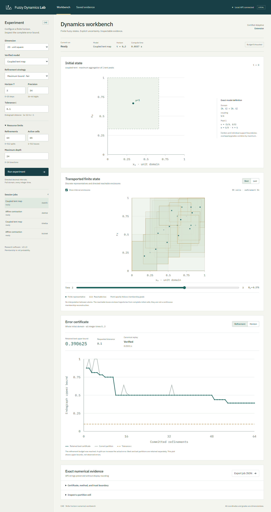
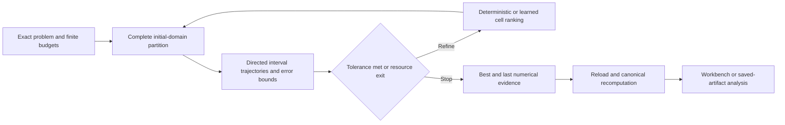
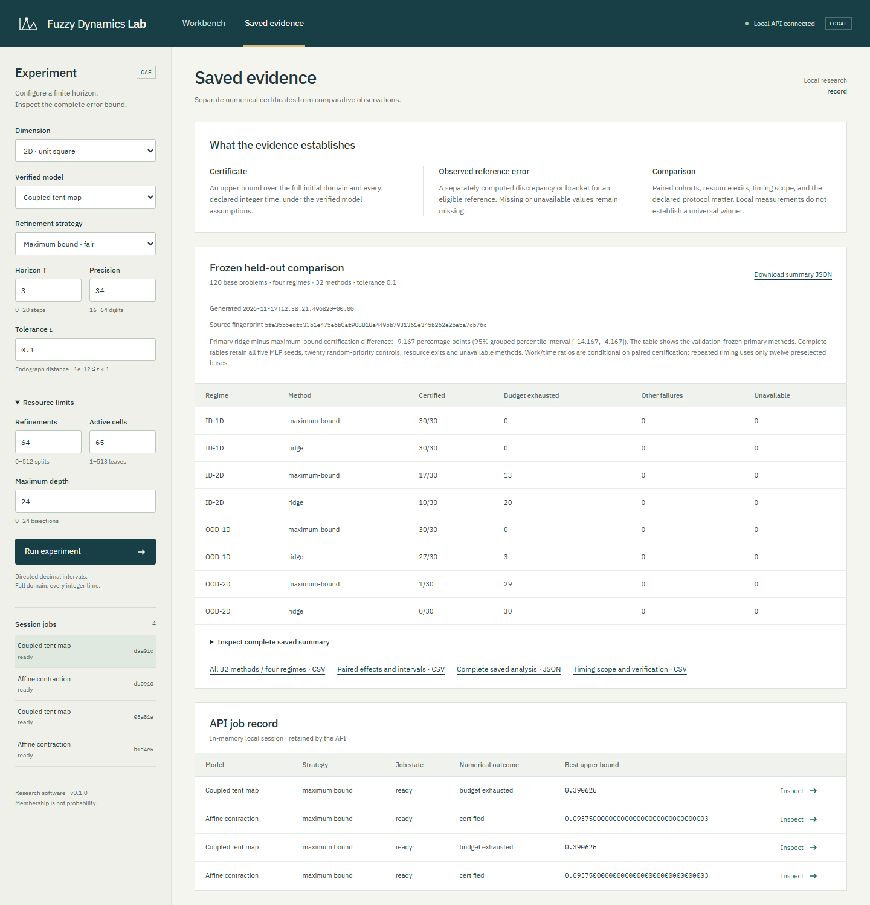

# Fuzzy Dynamics Lab

**Finite-horizon fuzzy dynamics, adaptive refinement, and replayable numerical evidence.**

Fuzzy Dynamics Lab is a Java and Python research workbench for discrete dynamical systems with fuzzy initial states. Its **Certified Adaptive Extension (CAE)** method refines a partition of the initial domain and computes an explicit upper bound on endograph error at every requested integer time. Deterministic policies and frozen learned rankers share the same numerical engine: learning chooses where to refine, while directed interval arithmetic determines the bound.

The project includes exact scalar references, a restricted published PWL transport baseline, isolated training and evaluation tools, a loopback Spring Boot API, and a React workbench. Membership grades are fuzzy memberships, not probabilities.

[Study PDF](https://github.com/gbalazsfalvi/fuzzy-dynamics-lab/releases/download/v0.1.0/fuzzy-dynamics-lab-study.pdf) · [Release v0.1.0](https://github.com/gbalazsfalvi/fuzzy-dynamics-lab/releases/tag/v0.1.0) · [Curated evidence](https://github.com/gbalazsfalvi/fuzzy-dynamics-lab/releases/download/v0.1.0/fuzzy-dynamics-lab-v0.1.0-evidence.zip) · [Complete data](https://github.com/gbalazsfalvi/fuzzy-dynamics-lab/releases/download/v0.1.0/fuzzy-dynamics-lab-v0.1.0-data.zip) · [Project case study](https://balazsfalvi.hu/work/fuzzy-dynamics-lab/)

**Measured finding:** the validation-selected ridge ranker reached tolerance on **67/120** held-out problems, versus **78/120** for maximum-bound selection. The primary certification difference was **−9.17 percentage points** (95% grouped percentile interval **[−14.17, −4.17]**). This frozen comparison did not support a learned-policy advantage. The complete outcomes, including losses and resource exits, are retained below and in the study.

## Try the workbench

Install **JDK 21** and **Node.js 24** with npm, then run from the repository root:

```powershell
.\gradlew.bat :api:run
```

On Linux or macOS, use `./gradlew :api:run`. The pinned Gradle 9.2.0 wrapper builds the TypeScript/React frontend and packages its static files into the Java API resources. Open [http://127.0.0.1:4180](http://127.0.0.1:4180). No separate frontend server, database, cloud account, or Python environment is needed for interactive experiments. The first build downloads locked dependencies.

Choose a verified map and membership profile, set a finite horizon and resource budget, and run a local job. Inspect the finite representatives, reachable boxes, per-time bounds, refinement history, and exact exported values. **Best** and **Last** remain separate because a refinement can increase the actual error. A budget exit is a valid reported outcome, not a tolerance success.





The service binds to `127.0.0.1:4180`, accepts only closed built-in mathematical presets and allowlisted model IDs, and runs one numerical worker with a bounded queue. It is a local research tool with no authentication or remote-service deployment claim. See the [workbench guide](docs/WORKBENCH.md) and [API contract](docs/API_CONTRACT.md) for development mode, admission limits, cancellation, and JSON fields.

## What is implemented

| Part | Role |
| --- | --- |
| `numerics-core` | Framework-free Java 21 exact rationals, directed decimal intervals, geometry, verified maps, membership profiles, CAE, frozen ranking inference, scalar cut references, and PWL transport |
| `experiments` | Demonstrations, train/validation label export, paired comparisons, provenance, saved numerical evidence, and deterministic replay |
| `learning` | Python 3.13 split generation, fixed ridge/MLP training, explicit weight export, parity fixtures, and pre-final protocol selection |
| `analysis` | Saved-artifact checks, paired statistics, model/base resampling, complete method tables, and publication figures |
| `api` | Spring Boot 4.0.9 loopback REST API, bounded asynchronous jobs, cooperative cancellation, and verified result projection |
| `web` | React/TypeScript controls, scalar and two-dimensional plots, exact evidence inspection, and JSON export |

The supported maps are affine contraction, tent, logistic, and a convex coupling of two tent maps on the unit square. Initial profiles are single or multiple tent peaks, including separated components and weak peaks. The core has **no third-party runtime dependencies**.



## Reading the evidence

A **certificate** is the computed whole-domain endograph upper bound under the stated map, membership, arithmetic, and coverage assumptions. It covers the complete requested finite horizon, including time zero. It does not promise accurate positive alpha cuts, infinite-horizon behavior, or a physical-system interpretation.

**Canonical replay** rebuilds the complete partition and recomputes its numerical quantities. It shares trusted interval primitives and the cell recipe with generation; independent exact and analytic reference tests address that shared implementation risk. It is not a formal proof checker. Exact rational parameters and mathematical decimal evidence are stored as strings, without passing through binary floats.

A **learned score** predicts signed local bound reduction per estimated child work. It changes selection only. Training-only normalization, disjoint base-problem groups, frozen weights, retained MLP seeds, and Python/Java parity keep model provenance explicit. A better label prediction need not produce a better solver.

An **observed reference discrepancy** and an **empirical comparison** answer different questions from certificate validity. Continuous scalar references have explicit reference error; joint two-dimensional reference geometry is unavailable. The PWL comparison reproduces the eligible exact transport specialization of Kupka and Škorupová (2021), excluding nonlinear PSO preprocessing and the authors' timings.

## Study design and results

The frozen design separates **64 training**, **24 validation**, and **120 held-out base problems**. The final cohort has four equally sized regimes: scalar and two-dimensional, each in and out of distribution. Its **32 methods** comprise four deterministic CAE policies, ridge, five MLP seeds, 20 seeded random-priority controls, and eligible scalar alpha-grid/PWL baselines. All outcomes remain in the paired cohort, including budget exits, failures, and unavailable methods. Only **12 preselected base problems** enter repeated timing comparisons; all 120 enter certification and algorithm-work analysis.

Validation selects the primary deterministic comparator and learned family before final outcomes. The MLP family retains all five seeds if selected. Final execution requires a matching source/protocol/model/analysis freeze and a fresh output directory. The [analysis plan](docs/ANALYSIS_PLAN.md) defines the estimands, uncertainty calculations, timing scope, and unavailable statistics.

All **3,700 eligible numerical runs**, the **3,840 declared outcomes** and diagnostics passed saved-artifact Java replay. The other **140 rows are unavailable comparisons**, retained explicitly. Ridge had 53 budget exits; maximum-bound had 42. Neither primary method had another failure status. Per-regime outcomes and exact provenance are recorded in the [evaluation milestone](docs/milestones/05.md).

On the **67/120 pairs where both primary methods certified**, the conditional median map-image ratio (ridge/maximum-bound) was **1.110**, with descriptive 95% interval **[1.000, 1.202]**. The conditional total-time ratio was **1.389 [1.197, 1.621]** on only **7/12** preselected timing pairs. Those are successful-pair comparisons, not unconditional speedups; local external load was uncontrolled, and solve time includes inference. Training amortization is unavailable because complete comparable pipeline cost was not recorded.

The qualified scalar audit had **1,200 discrepancy brackets from six bases**, **zero verified lower-bound violations**, and **72 upper-only exceedances that remain inconclusive**. These method/time rows are not independent scientific problems. This is tested scalar evidence, not a proof of all certificates or joint 2D reference accuracy. All five MLP seeds and twenty random-priority controls remain in the full 128-row method/regime table.

The matching final analysis SHA-256 is `6880c75e6e612edc213c660d7155eb44f07277b03b653a4b7ea46a2f04922f28`. The [locked protocol](research/protocols/evaluation-locked-v1.json), [pre-result freeze](research/evaluation-freeze-v1.json), replay receipt and complete input hashes accompany the release evidence. These fingerprints identify bytes and provenance; they are not authenticated pre-registration or proof of mathematical truth.



## Reproduce and verify

For the build and small numerical examples:

```powershell
.\gradlew.bat --dependency-verification=strict clean build
.\gradlew.bat foundationDemo caeDemo
.\gradlew.bat verifyCaeDemo
```

The final command reads the saved CAE artifact without regenerating it. Java checks include formatting, Javadoc, warnings as errors, tests, and coverage. The numerical core requires at least **95% line** and **90% branch** coverage. The root build also builds the packaged frontend and runs its behavioral unit tests.

Python 3.13 is needed for model training and saved-artifact analysis. Start with the hash-locked environment, then follow the [reproducibility guide](docs/REPRODUCIBILITY.md) for distinct demonstration, training, validation, freeze, evaluation, replay, analysis, and PDF stages. Large study runs and retraining are deliberate research operations; they are not part of the default build or CI.

Release evidence records source/build-input, protocol, model, payload, and analysis SHA-256 hashes. These fingerprints support consistency checks and exact artifact identification; they are not signatures or authentication. Frozen model files should be reused when reproducing a release's numerical decisions. A new fit is a new artifact even when it uses the same seed.

**Measured source and release maintenance:** the saved study was generated and replayed with commit [`253c2de`](https://github.com/gbalazsfalvi/fuzzy-dynamics-lab/tree/253c2de108991eef56ad2f9c0294d43ad74edeb7), tagged `study-source-v1`. The release additionally completes 17 reviewed dependency-metadata checksums needed by a cold full build. Numerical code, dependency versions, models, protocols, analysis and saved outcomes are unchanged. Because verification metadata belongs to the frozen build-input digest, replay downloaded study evidence in that exact measured checkout, following the [restoration instructions](docs/REPRODUCIBILITY.md#restore-and-replay-the-published-study). Do not substitute the current release's digest for the measured fingerprint.

## Documentation

| Read | Purpose |
| --- | --- |
| [Numerical contract](docs/NUMERICAL_CONTRACT.md) · [CAE method](docs/CAE_METHOD.md) | Arithmetic assumptions, covering bounds, refinement, and replay |
| [Comparison method](docs/COMPARISON_METHOD.md) · [Analysis plan](docs/ANALYSIS_PLAN.md) | References, paired cohorts, timing, and interpretation |
| [Learning milestone](docs/milestones/04.md) · [Model card](learning/MODEL_CARD.md) · [Evaluation milestone](docs/milestones/05.md) | Delivered models, data, optimizer outcomes, and measured findings |
| [Workbench milestone](docs/milestones/06.md) · [Study and publication](docs/milestones/07.md) | Interface behavior, evidence assets and bilingual presentation |
| [Study source](research/report/main.tex) · [PDF export guide](research/report/README.md) | Mathematical/software report and evidence import |
| [Proof obligations](docs/PROOF_OBLIGATIONS.md) · [Internal mathematical review](docs/INDEPENDENT_RESEARCH_REVIEW.md) | Derivations, checked assumptions, and review boundaries |
| [Research review](docs/RESEARCH_REVIEW.md) · [Source register](research/source-register.json) | Literature eligibility and unresolved source access |
| [Milestones 00–01](docs/milestones/00-01.md) · [02](docs/milestones/02.md) · [03](docs/milestones/03.md) | Foundation, deterministic solver, and exploratory pilot history |

The mathematical review is internal, with disclosed AI assistance. Independent external review and detailed comparison with the 2007/2016 closest full texts and additional 2008 multivariate work remain open. The software and study establish no scientific novelty claim. Fixed precision and finite resources can prevent reaching tolerance.

## License and citation

Source code is licensed under [Apache License 2.0](LICENSE). See [NOTICE](NOTICE) for attribution and [CITATION.cff](CITATION.cff) for software citation metadata. Cite the exact release and evidence artifacts used, and distinguish the numerical method, heuristic selection policy, and empirical claims in derived work. See [SECURITY.md](SECURITY.md) for the local-service security scope.

The packaged browser application carries unchanged [third-party notices](web/public/licenses/README.txt), including the IBM Plex font licenses and React's MIT license.
