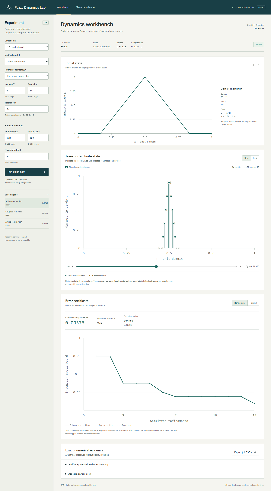
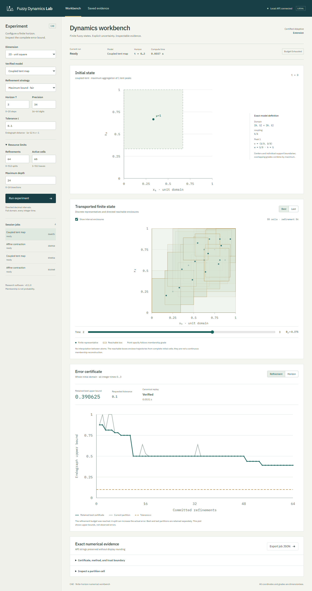
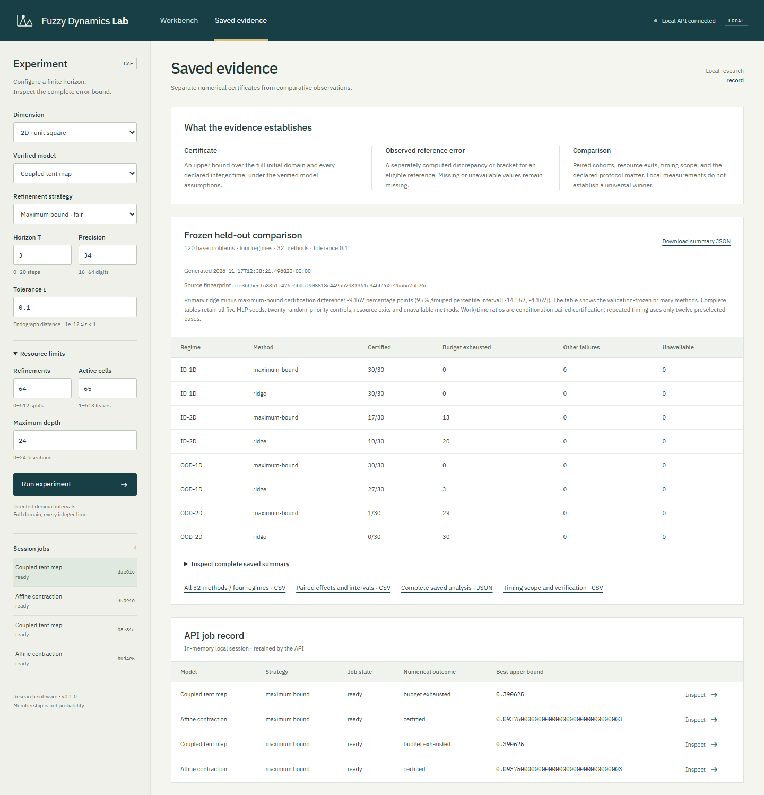

# Milestone 06: local scientific workbench

**Scope:** a real Spring Boot API and React/TypeScript interface for bounded CAE experiments. The workbench uses the numerical implementation directly and does not substitute fabricated result data.

## Delivered behavior

The packaged application runs with `./gradlew :api:run` (Windows: `.\gradlew.bat :api:run`) and serves both the workbench and API at [http://127.0.0.1:4180](http://127.0.0.1:4180). The Gradle resource pipeline builds `web/dist` and includes it under the API's static resources. JDK 21 and Node.js 24 are required; Python is not needed to run an interactive experiment with the included frozen models.

The application distribution includes native start scripts. Its Windows script uses Java's quoted `lib\*` classpath wildcard to avoid CMD's command-length limit in long installation paths, while retaining Gradle's JVM-option and argument handling. Launch the extracted script from the repository root when using the included frozen models; an explicit `--lab.models-directory` can select another intended export directory.

Users select one of four closed presets: affine contraction, tent, logistic, or coupled tent. Exact profile parameters are supplied by the API. Controls expose strategy, significant decimal precision, finite horizon, tolerance, and refinement/cell/depth budgets. A ranked strategy requires an allowlisted frozen model ID.

One numerical worker and a two-job waiting queue bound concurrent execution; at most twenty job records are retained. Admission checks reject excessive individual or combined budgets before numerical work begins. Jobs support cooperative cancellation and report queue, running, cancellation, ready, and failure states. Ready means the outcome is available; only the numerical `CERTIFIED` outcome means its retained bound meets tolerance.

Before exposing a completed outcome, the API recomputes both available best and last snapshots with the canonical certificate verifier. Cancellation and execution failure expose no manufactured certificate. Mathematical decimals and fractions remain strings in JSON, including exported trajectories and bounds.

## Scientific presentation

The time cursor selects an integer slice of the finite horizon. Scalar views display finite representatives as stems/points; two-dimensional views display representatives and reachable boxes. The initial partition remains distinguishable from transported geometry. Best and Last select different complete snapshots when necessary. Bound charts show the retained incumbent and current-partition refinement curves without assuming monotone refinement.

The exact inspector exposes original API strings, membership grade/error/variation/cap, initial boxes, reachable boxes, representative trajectories, residuals, radii, and time bounds. Initial membership previews are explicitly presentation samples and never drive certification. Binary floats used for chart coordinates do not replace the exact exported values. Membership is not normalized as probability.

The saved-evidence view reads an optional reviewed `web/public/results.json`. Its absence is an explicit unavailable state, not a source of demonstration numbers. Saved comparative outcomes remain separate from interactive certificates.

## Verification and local-service boundary

The API test suite covers admission validation, exact JSON types, a real numerical lifecycle, queued/running cancellation, overload, retention, validated model inference, HTTP errors, and origin checks. Frontend unit tests cover request/state/numerical-presentation behavior. Playwright exercises actual scalar and coupled jobs, the time cursor, best/last state, responsive layouts, and evidence presentation against a running API. Reproduction commands are in [REPRODUCIBILITY.md](../REPRODUCIBILITY.md).

The API binds only to `127.0.0.1`, rejects non-loopback clients/Host names, and guards mutation requests with same-origin checks. There is no permissive CORS policy, authentication service, database, or remote deployment claim. The Vite development proxy rewrites only its explicit same-origin loopback development requests; foreign origins remain rejectable. See [API_CONTRACT.md](../API_CONTRACT.md) and [WORKBENCH.md](../WORKBENCH.md).

This interface does not establish comparative speed, scientific novelty, joint two-dimensional reference accuracy, or external mathematical review. A finite budget can end before tolerance is reached, and a small endograph bound does not imply accurate positive alpha cuts. The interface preserves these distinctions rather than turning every terminal job into a success claim.
